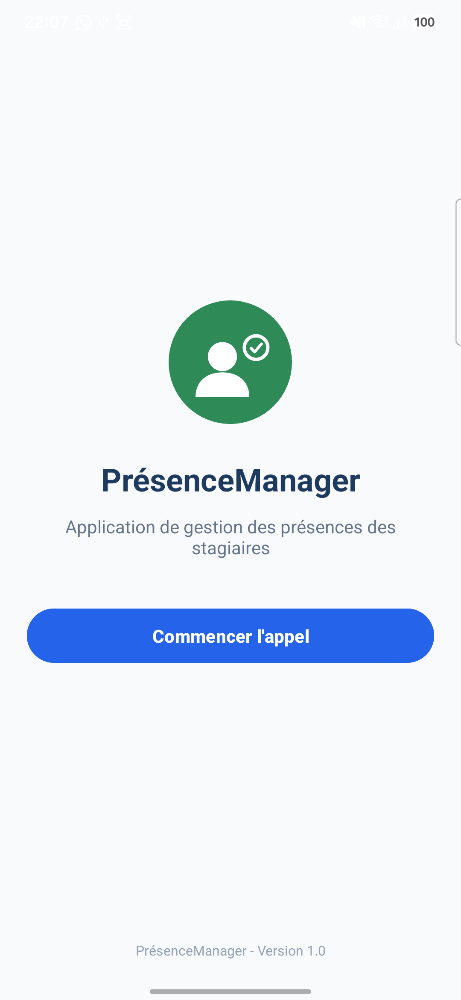
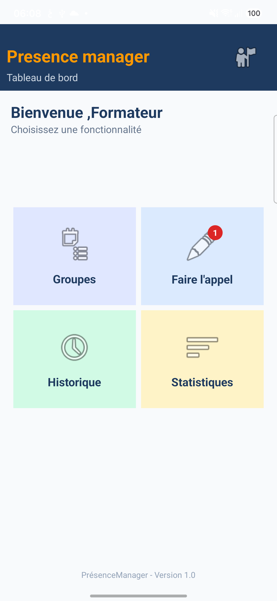
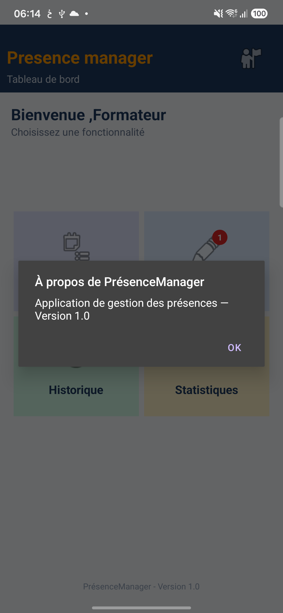
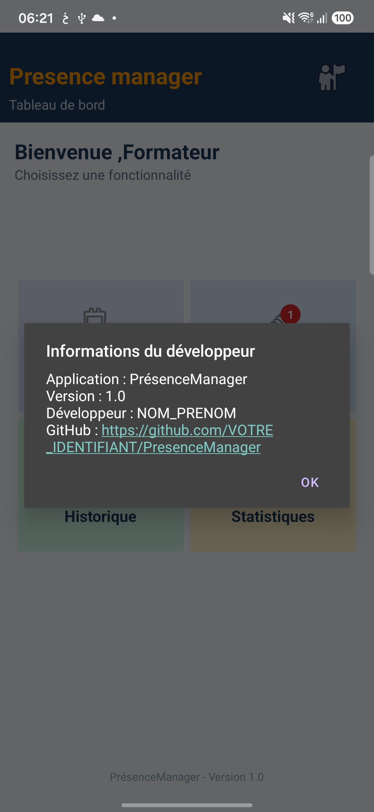

# PrésenceManager

Application Android (Kotlin + XML) destinée à faciliter la gestion des présences des stagiaires dans un établissement de formation.

## TP01 — Interface d'accueil

Écran d'accueil (`MainActivity` / `activity_main.xml`) :

- logo de l'application
- titre « PrésenceManager »
- description de l'application
- bouton « Commencer l'appel » (`btnCommencer`)
- pied de page « PrésenceManager - Version 1.0 » (`txtFooter`)

Technologies : Kotlin, XML, LinearLayout

## TP02 — Tableau de bord

Tableau de bord (`Dashboar` / `activity_dashboar.xml`) avec quatre cartes : Groupes, Faire l'appel, Historique et Statistiques, une icône de profil dans l'en-tête et un pied de page « Version 1.0 ».

Identifiants conservés : `cardGroupes`, `cardAppel`, `cardHistorique`, `cardStatistiques`, `imgProfil`, `txtFooterDashboard`.

## TP03 — Gestion des événements

### Définitions

Un **événement utilisateur** est une action effectuée par l'utilisateur sur l'écran (appui, appui prolongé, double appui). Un **Event Listener** associe une réaction à un composant : l'événement est ensuite traité dans le code Kotlin.

### Différence entre les trois gestes

- **Clic simple (`onClick`)** : appui bref sur un composant.
- **Appui long (`onLongClick`)** : appui maintenu ; le listener retourne `true` pour indiquer que l'événement est consommé et éviter de déclencher aussi le clic simple.
- **Double-clic (`onDoubleTap`)** : deux appuis rapprochés. Il n'existe pas de `OnDoubleClickListener` standard dans Android ; on utilise `GestureDetector` avec `SimpleOnGestureListener` et `setOnTouchListener`.

### Événements traités

| Événement | Composant | Action |
|---|---|---|
| Clic simple (`OnClickListener`) | Les 4 cartes du tableau de bord | Ouvre l'activité associée |
| Appui long (`OnLongClickListener`) | `cardGroupes` et `cardAppel` | Affiche un Toast d'aide, sans navigation |
| Double-clic (`GestureDetector` / `onDoubleTap`) | `imgProfil` | Boîte de dialogue « À propos » |
| Clic simple (`OnClickListener`) | `txtFooter` et `txtFooterDashboard` | Boîte « Informations du développeur » avec lien GitHub et OK |
| Clic simple (`OnClickListener`) | `btnCommencer` | Ouvre le tableau de bord |

Le double-clic est volontairement placé sur `imgProfil` et non sur une carte, pour éviter le conflit avec l'ouverture immédiate d'une activité au premier clic.

### Pages accessibles depuis le tableau de bord

- `GroupesActivity` (Groupes)
- `AppelActivity` (Faire l'appel)
- `HistoriqueActivity` (Historique)
- `StatistiquesActivity` (Statistiques)

Ces pages affichent pour le moment le titre de la fonctionnalité et le message « Fonctionnalité en cours de développement ». La gestion des données sera abordée dans les prochains TP.

### Informations du développeur

Un clic sur « PrésenceManager - Version 1.0 » (écran d'accueil ou tableau de bord) ouvre une boîte de dialogue « Informations du développeur » contenant :

- le nom de l'application et sa version
- le nom du développeur
- le lien GitHub du projet (cliquable grâce à `Linkify` et `LinkMovementMethod`)
- un bouton « OK »

### Captures d'écran

**Tableau de bord**

**Page ouverte par clic simple (Groupes)**

**Boîte de dialogue du double-clic (« À propos »)**

**Boîte de dialogue « Informations du développeur »**

